# Executive One-Pager: FinOps & Antigravity Vibe Coding Initiative
### Unlocking 10x Practitioner Scalability, Rapid Cloud Cost Optimization & Zero-Trust Enterprise Delivery

> [!IMPORTANT]
> **Executive Value Proposition (`10x Scalability`)**
> The **Vibe Coding FinOps with Antigravity AI Agents** initiative transforms Cloud Financial Management from static spreadsheets and months-long internal engineering backlogs into a **3-hour, repeatable, self-service capability**. By combining **Antigravity IDE's autonomous agentic workflows** with **Vertex AI (`gemini-2.5-flash`)**, **BigQuery FOCUS Billing Exports**, and **Zero-Trust Cloud Run + Cloud Armor WAF** Terraform automation, any Customer Engineer (CE), Outcome Customer Engineer (OCE), Technical Account Manager (TAM), or FinOps practitioner can build, verify, and deploy a production-grade FinOps web application using pure natural language prompts.

---

## 1. The Challenge vs. The Agentic Vibe Coding Breakthrough

| Dimension | Traditional Custom FinOps Tooling | FinOps Vibe Coding with Antigravity AI (`10x Model`) | Strategic Impact |
| :--- | :--- | :--- | :---: |
| **Time-to-Production** | **4 to 6 Weeks** of dedicated frontend, backend, data, and DevSecOps engineering | **3 Hours (`4 x 45-Min Sprints`)** from blank folder to live Cloud Run + Cloud Armor URL | **10x Faster Delivery** |
| **Who Can Build** | Restricted to full-stack software developers (`<10%` of field & FinOps teams) | **100% of Field & FinOps Practitioners** (OCEs, TAMs, CEs, FinOps Analysts) via plain English | **10x Builder Reach** |
| **Data & AI Grounding** | Disconnected CSV exports and manual SQL scripts | Live **BigQuery Billing Exports** (`Standard`, `Resource`, `Pricing`) + keyless **Vertex AI `gemini-2.5-flash`** NLQ | **Real-Time Cost Intelligence** |
| **Security & Governance** | Ad-hoc prototypes exposed without WAF or security headers | **Zero-Trust by Default**: Global HTTPS Load Balancer, Cloud Armor WAF (`SQLi`/`XSS` `403`), CSP/HSTS, non-root container | **Enterprise Production Ready** |
| **Enablement Scalability** | Custom 1-off consulting engagements | Turnkey **"Workshop-in-a-Box"** registered in **EMEA SPARK (`go/emea-spark-overview-page`)** | **10x Regional Replication** |

---

## 2. The 4 Pillars of 10x Scalability & Business Value

```mermaid
flowchart LR
  subgraph P1 ["1. 10x Engineering Velocity"]
    V1["6 Weeks -> 3 Hours"]
    V2["4 x 45-Min Agentic Sprints"]
    V3["Autonomous Build & Test Loops"]
  end

  subgraph P2 ["2. 10x Practitioner Democratization"]
    D1["Zero Manual Coding Required"]
    D2["Plain-English AGENTS.md Contract"]
    D3["Every TAM, OCE & FinOps Lead Builds"]
  end

  subgraph P3 ["3. 10x EMEA Workshop Replication"]
    R1["Turnkey Workshop-in-a-Box Kit"]
    R2["3-Avatar Video + Google Template Decks"]
    R3["Published on EMEA SPARK Catalog"]
  end

  subgraph P4 ["4. 10x Customer FinOps ROI"]
    C1["20-35% Cloud Waste Identification"]
    C2[">30% 7-Day Median Anomaly Radar"]
    C3["Live CUD & Rightsizing Simulator"]
  end

  P1 ==> P2 ==> P3 ==> P4
```

1. **10x Engineering Velocity (`From 6 Weeks to 3 Hours`)**:
   - Instead of writing thousands of lines of boilerplate code, practitioners steer **Antigravity** (the autonomous AI agent engine) inside **Antigravity IDE** (the interactive visual workspace combining Agent Mission Control, Code Editor, Terminal, and Live Browser Preview).
   - Across four structured 45-minute sprints (30 minutes of non-technical architectural framing + 15 minutes of autonomous agent execution), the agent scaffolds the project, builds the UI, wires BigQuery and Vertex AI, verifies every button, and hardens the container automatically.
2. **10x Practitioner Democratization (`Non-Developers Building Production Apps`)**:
   - Eliminates the bottleneck between FinOps domain experts (who know *what* cost anomalies and rightsizing rules matter) and software engineers.
   - Domain experts express FinOps logic directly in natural language—creating custom KPI cockpits, granular consumption scoping (`Single Project`, `Multiple Selected Projects`, `Entire Organization`), and executive reports tailored to each customer's CFO and FinOps team.
3. **10x Regional Replication (`Turnkey "Workshop-in-a-Box" in EMEA SPARK`)**:
   - Every asset required to pitch, teach, and deploy the solution is packaged into a reusable kit in Google Drive and GitHub (`imedtra/spark-finops-vibe-coding`), enabling any EMEA sub-region to run executive FinOps Build Days with zero prep time.
4. **10x Customer FinOps & Security Value (`Immediate Cloud Savings + Zero-Trust WAF`)**:
   - **Actionable FinOps Capabilities**: Normalizes multi-cloud billing records to the **FOCUS v1.0** specification, detects daily cost spikes `>30%` over the 7-day rolling median, simulates Compute & CUD rightsizing savings with 1-click undo, and answers plain-English questions via **Vertex AI `gemini-2.5-flash`**.
   - **Defense-in-Depth Security**: Fronted by a **Global External Application Load Balancer (`https://finops.136.68.166.131.nip.io`)** and **Google Cloud Armor WAF** enforcing OWASP SQLi (`Rule 1000`), OWASP XSS (`Rule 1100`), and IP rate limiting (`100 req/min/IP`, `Rule 5000`).

---

## 3. Complete Showcase Kit & Document Inventory

All workshop, presentation, video, and code assets are centralized in the **[FinOps and Vibe Coding Google Drive Folder](https://drive.google.com/drive/folders/1f2YN5RzAP0vwq510hiNxnMyb3Bp6sCIc)** and the **[EMEA SPARK GitHub Repository (`imedtra/spark-finops-vibe-coding`)](https://github.com/imedtra/spark-finops-vibe-coding)**:

| Category | Asset Name | Link | Role in Customer & Internal Showcases |
| :--- | :--- | :--- | :--- |
| **📁 Drive Hub** | **FinOps and Vibe Coding (Master Folder)** | **[Open Drive Folder](https://drive.google.com/drive/folders/1f2YN5RzAP0vwq510hiNxnMyb3Bp6sCIc)** | Central Google Drive repository containing the decks, playbooks, handouts, one-pager, and video. |
| **📄 One-Pager** | **Executive One-Pager & 10x Scalability Case (Google Doc)** | **[Open Google Doc](https://docs.google.com/document/d/1Gt6gUvro8V3IcmoU4KQmCIxsrF-qP858gDO30oKzxJc/edit)** | 1-page executive brief highlighting the 4 levers of 10x scalability, ROI metrics, and showcase inventory. |
| **🎬 Video** | **3-Presenter Animated Cartoon Avatar Video (`2m 21s`)** | **[Watch on Drive](https://drive.google.com/file/d/18DmQSwadPun1toT3SKPGI__dzGdzKx7C/view)** | Co-presented by **Imed** (`AI Solutions Lead`), **Hasnae** (`Technical Account Manager`), and **Dr Nabil** (`Outcome Customer Engineer`). |
| **📊 Deck #1** | **Executive Value & 10x Scalability Deck (Google Template)** | **[Open Google Slides](https://docs.google.com/presentation/d/1WjajCh-JcooBmwWar9AokmbBICTvSDZYsLv2O7TI1UY/edit)** | 8-slide executive briefing on the 10x scalability model, ROI metrics, and showcase kit. |
| **📊 Deck #2** | **Cloud FinOps + Antigravity Vibe Coding (73-Slide Integrated Deck)** | **[Open Google Slides](https://docs.google.com/presentation/d/1eiZsfCEzmOv8KLmdmvWXlw7FOyBeIvyDvHg4vB7VGlM/edit)** | Main 3-hour workshop deck with 2 non-technical Google template explainer slides every 30 minutes + Zero-Trust architecture. |
| **📊 Deck #3** | **The Google AI & Antigravity Ecosystem (11-Slide Deck + Video)** | **[Open Google Slides](https://docs.google.com/presentation/d/1HUF1ODOw-2VpPUMKqF0SgFe_dm7EZrH-hKf2W1km-ac/edit)** | Introduces Gemini Enterprise, NotebookLM, Google AI Studio, and Antigravity Engine vs. Antigravity IDE. |
| **📊 Deck #4** | **Vibe Coding FinOps (16-Slide Standalone Deck)** | **[Open Google Slides](https://docs.google.com/presentation/d/1eHXxUsyIdGJ3_1iQQ7IvJjSGXh04jNCHeSaOQn1xMsU/edit)** | Fast-track standalone workshop deck in the official Google Cloud white template. |
| **📘 Doc #1** | **3-Hour Master Workshop Playbook & Instructor Guide** | **[Open Google Doc](https://docs.google.com/document/d/1rfQ04Fe_O4AH02sNZg7DN0mEXHlgqjdNfW1gaWbeFL4/edit)** | Full 180-minute syllabus, presenter script, *"While the Agent Works"* bridges, and troubleshooting guide. |
| **📄 Doc #2** | **Attendee Quick-Start Lab Handout (Prompts #1–#5)** | **[Open Google Doc](https://docs.google.com/document/d/1cxPIHCd-r_dRp9N8-4_GpQdXMBrOh2q7uJIcA8iSpfg/edit)** | Copy-paste Vibe Coding prompts for all 4 sprints + Sprint 5 Cloud Run & Cloud Armor deployment. |
| **🏛️ Architecture** | **System & Zero-Trust Security Architecture (`ARCHITECTURE.md`)** | **[View on GitHub](https://github.com/imedtra/spark-finops-vibe-coding/blob/main/docs/ARCHITECTURE.md)** | 5-layer Mermaid topology, sequence flows, REST API contracts, and `SEC-01`–`SEC-05` hardening matrix. |
| **🌐 Live App** | **Production FinOps Cloud Console (`argolis-finops-hub-14419`)** | **[Launch HTTPS LB + WAF](https://finops.136.68.166.131.nip.io)** | Live application on Cloud Run (`Port 8081`) fronted by Global HTTPS Load Balancer & Cloud Armor WAF. |
| **🐙 Git & SPARK** | **EMEA SPARK GitHub Repo & Portfolio Entry (`PR #681`)** | **[Open GitHub Repo](https://github.com/imedtra/spark-finops-vibe-coding)** | Full source code, Terraform IaC, and registration on **[go/emea-spark-overview-page](https://upgraded-couscous-l6jpvvq.pages.github.io/)**. |
